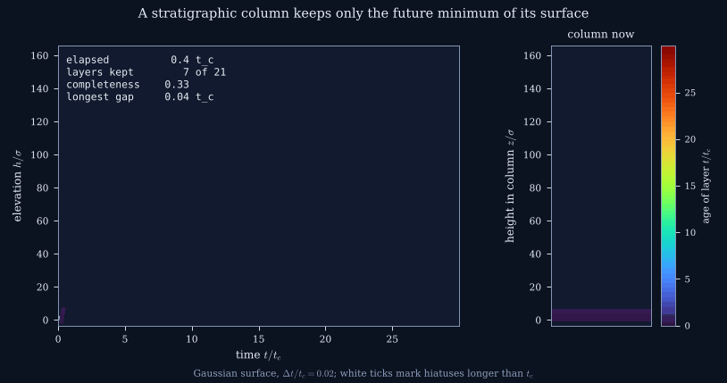
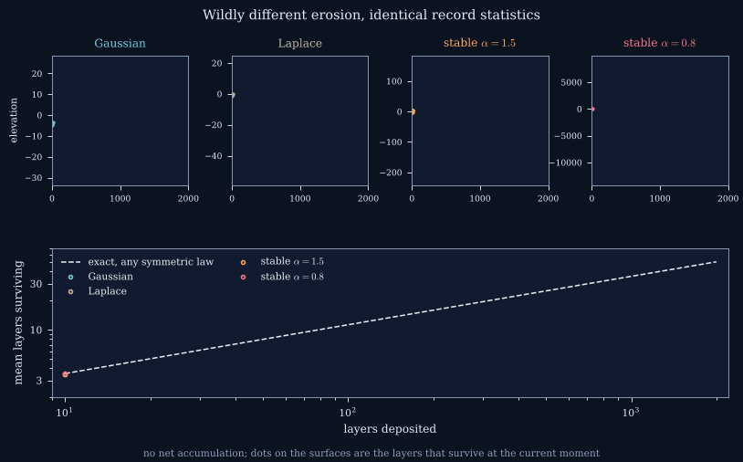
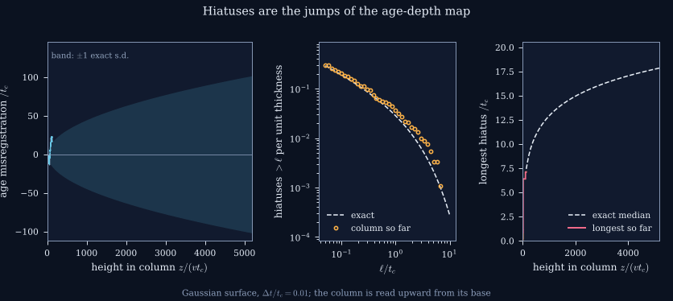
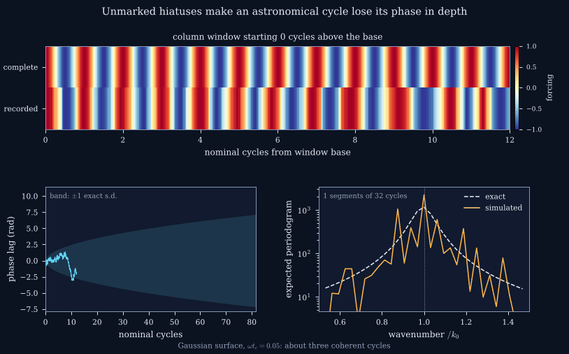

# Stratigraphic Universality

Supplementary code for the manuscript

> **Universality and Information Loss in the Stratigraphic Record**
> Sandy H. S. Herho, Dasapta E. Irawan, and Rubiyanto Kapid

Sediment deposited at a given moment survives only if the depositional
surface never later erodes below it. The preserved stratigraphic column is
therefore the *future minimum* of the surface elevation history. This
repository treats that rule as a filter acting on an idealized stochastic
surface and verifies, by direct simulation, every analytical result in the
paper: exact completeness, the universality classes of the Sadler effect,
the statistics of hiatuses and of the longest hiatus, and the way an
astronomical cycle is broadened and shifted when it is read in depth.

The model is idealized. It uses no observational data, and no number in it
is an estimate for a particular basin or section.

<p align="center">
  
</p>

## The model in brief

The surface elevation at resolution `dt` follows

```
h_n = h_{n-1} + mu + xi_n ,    mu = v dt ,
```

where `v` is the long-term accumulation rate and `xi_n` are fluctuations
(Gaussian, Laplace, Student t, symmetric alpha-stable, or fractional
Gaussian noise). Layer `n` is preserved if and only if `h_n < h_m` for every
later `m`. Drift and fluctuations balance at the crossover time
`t_c = D / v^2`, and results are expressed in the reduced resolution
`eps = dt / t_c`.

| Result | Where |
| --- | --- |
| Completeness is exact via Spitzer's identity; `c ~ sqrt(dt/t_c)` with prefactor one for every symmetric finite-variance law, plus a `zeta(1/2)` correction | `compute_completeness.py`, Fig. 2 |
| Sadler exponent equals the persistence exponent: `1/2` for independent increments (heavy tails included), `1 - H` with memory | `compute_completeness.py`, Fig. 2 |
| Driftless columns preserve `(2n+1) C(2n,n) 4^-n` layers for every symmetric law | `compute_driftless.py`, Fig. 2 |
| The age-depth map is a subordinator; hiatus counts follow its Levy measure and the longest hiatus has a closed-form law | `compute_hiatus.py`, `compute_longest.py`, Fig. 3 |
| A periodic forcing appears in depth as a Lorentzian line, broadened and shifted to longer apparent periods | `compute_coherence.py`, Fig. 4 |
| Age misregistration scales as `dz^(1/2)`, `dz^(1/alpha)` or `dz^H` by class | `compute_misregistration.py`, Fig. 4 |
| Chronometric information decays over about `P / (4 pi^2 t_c)` cycles | `fig05_information.py`, Fig. 5 |

## Repository layout

```
stratigraphic_universality/
├── stratigraphic_universality/   # the package
│   ├── generators.py             # surface laws (CMS stable, Davies-Harte fGn)
│   ├── record.py                 # the stratigraphic filter and observables
│   ├── theory.py                 # exact results used for verification
│   ├── io.py                     # output paths, CSV and figure helpers
│   ├── plotting.py               # figure style
│   └── anim_style.py             # animation style
├── scripts/
│   ├── compute_*.py              # simulations (results cached as .npz)
│   ├── fig01_filter.py ... fig05_information.py
│   ├── anim01_column.py ... anim04_cycles.py
│   ├── make_reports.py           # every number quoted in the paper
│   └── run_all.py                # the whole pipeline
└── outputs/
    ├── figures/                  # PDF and 600 dpi PNG
    ├── animations/               # GIF
    ├── data/                     # CSV behind each figure panel
    └── reports/                  # plain-text reports
```

## Installation

Python 3.9 or later.

```bash
git clone https://github.com/sandyherho/stratigraphic_universality.git
cd stratigraphic_universality
pip install -e .
```

The only dependencies are NumPy, SciPy, Matplotlib and Pillow.

## Reproducing the results

```bash
python scripts/run_all.py            # simulations, figures, reports, animations
python scripts/run_all.py --no-anim  # skip the animations
```

The full pipeline takes about twenty minutes on a laptop. Each script can
also be run on its own; the figure and report scripts read the cached
results in `outputs/cache/`. All random seeds are fixed, so the outputs
reproduce the numbers in the manuscript exactly.

A minimal example:

```python
import numpy as np
from stratigraphic_universality import surface, preserved, spitzer_completeness

rng = np.random.default_rng(0)
eps = 0.01                                  # dt / t_c
h = surface("gauss", 2**20, eps, rng)       # elevation history
print(preserved(h)[:-20000].mean())         # simulated completeness
print(spitzer_completeness(np.sqrt(eps / 2)))  # exact
```

## Figures

| | |
| --- | --- |
| `fig01_filter` | The filter: a surface, its future minimum, and the column |
| `fig02_completeness` | Completeness, its universality, and the driftless limit |
| `fig03_hiatus` | Hiatus durations, counts per thickness, longest hiatus |
| `fig04_lineshape` | A periodic forcing in depth; age misregistration |
| `fig05_information` | Chronometric information and the coherence horizon |

## Animations

**Wildly different erosion, identical record statistics.** Four driftless
surfaces with Gaussian, Laplace and two stable fluctuation laws look nothing
alike, yet the mean number of surviving layers follows one exact curve.

<p align="center">
  
</p>

**Hiatuses are the jumps of the age-depth map.** Reading a finished column
from its base: the age misregistration wanders like a random walk, hiatus
counts converge to the exact Levy measure, and the longest hiatus tracks its
exact median.

<p align="center">
  
</p>

**Unmarked hiatuses make an astronomical cycle lose its phase in depth.**
The complete and the recorded forcing drift out of step, the phase lag
diffuses within its exact band, and the depth spectrum converges to the
exact line shape.

<p align="center">
  
</p>

In every animation the color scale spans exactly the range of the plotted
quantity.

## Citation

If you use this code, please cite the manuscript and this repository (see
`CITATION.cff`).

## Funding

Faculty of Earth Sciences and Technology (FITB), Bandung Institute of
Technology (ITB), PPMI Research Program 2026 (FITB.PPMI-1-19-2026), and the
ITB 3P Research Program, Talenta Unggul Scheme (DRI.PN-6-64-2026).

## License

MIT License. Copyright (c) 2026 Applied Geology Research Group, Bandung
Institute of Technology.
